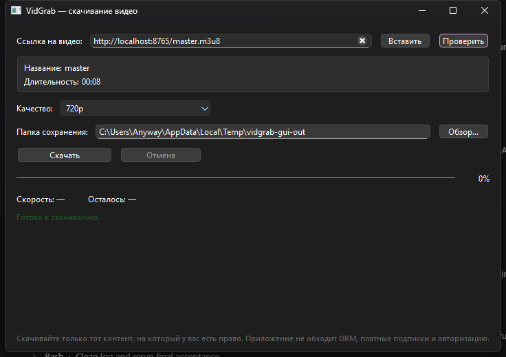

# VidGrab — скачивание видео по ссылке

Портативное приложение для Windows: вставляете ссылку на видео, выбираете качество и папку — видео скачивается с прогрессом. Не требует установки Python и ничего не пишет в системный реестр: достаточно распаковать папку и запустить `VidGrab.exe`.

> **Скачивайте только тот контент, на который у вас есть право.**
> Приложение не обходит DRM, платные подписки и авторизацию.



## Что умеет

- YouTube и VK Video (`vkvideo.ru`, `vk.com`), а также сайты, которые поддерживает встроенный `yt-dlp`;
- показывает название и длительность видео, доступные качества: `360p`, `480p`, `720p`, `1080p`, `best`;
- скачивает в выбранную папку, показывает проценты, скорость и оставшееся время;
- загрузку можно отменить — недокачанные файлы удаляются;
- после завершения показывает путь к файлу и кнопку «Открыть папку»;
- запоминает последнюю папку и качество;
- понятные сообщения об ошибках (нет сети, приватное видео, нет прав на запись и т.д.);
- сеть нужна только для проверки ссылки и загрузки видео.

## Требования

| Что | Значение |
|---|---|
| ОС | Windows 10/11 x64 (проверено на Windows 11 10.0.26300) |
| Python | не нужен |
| Свободное место | около 450 МБ (папка приложения) |
| Интернет | нужен только для проверки ссылки и загрузки |

## Установка и запуск

1. Скопируйте папку `VidGrab` целиком (в ней `VidGrab.exe` и папка `_internal`) в удобное место, например `D:\Apps\VidGrab`.
2. Запустите `VidGrab.exe`.
3. Не перемещайте `VidGrab.exe` отдельно от `_internal` — приложение не найдёт библиотеки и `ffmpeg`.

При первом запуске Windows SmartScreen может показать предупреждение (файл не подписан): «Подробнее» → «Выполнить в любом случае». Приложение не устанавливает службы и не лезет в автозагрузку.

## Как скачать видео

1. Скопируйте ссылку на видео и вставьте её в поле «Ссылка на видео» (кнопка «Вставить» берёт ссылку из буфера обмена).
2. Нажмите «Проверить». Появится название, длительность и список доступных качеств.
3. Выберите качество и папку сохранения (кнопка «Обзор…»).
4. Нажмите «Скачать». Прогресс, скорость и оставшееся время отображаются под кнопками.
5. При необходимости нажмите «Отмена» — загрузка остановится, недокачанный файл будет удалён.
6. После завершения нажмите «Открыть папку», чтобы перейти к файлу.

Примеры ссылок:

```
https://www.youtube.com/watch?v=...
https://vksport.vkvideo.ru/video-29484355_456253450
```

Одна ссылка — одно видео. Плейлисты не поддерживаются. Если видео приватное, платное или защищено DRM, приложение сообщит, что оно недоступно, и не будет пытаться обойти защиту.

### Качества

Показываются только реально доступные варианты из списка `360p`, `480p`, `720p`, `1080p`, `best`. `best` — максимальное доступное качество. Видео и звук при необходимости склеиваются в MP4 встроенным `ffmpeg`, поэтому итоговый файл всегда воспроизводимый.

## Где хранятся настройки и файлы

| Что | Где |
|---|---|
| Настройки | `%APPDATA%\VidGrab\settings.json` |
| Лог | `%APPDATA%\VidGrab\vidgrab.log` (ротация 1 МБ × 3) |
| Отчёт самопроверки | `%APPDATA%\VidGrab\selftest.json` |
| Скачанные видео | папка, выбранная в окне (по умолчанию `%USERPROFILE%\Downloads\VidGrab`) |

В лог попадают ссылки и пути файлов — это нужно для диагностики. Приложение не отправляет телеметрию и не делает сетевых запросов, кроме обращения к сайту видео.

## Если что-то пошло не так

| Сообщение | Что делать |
|---|---|
| «Ссылка пустая или некорректная» | Проверьте ссылку: нужна `http://` или `https://` |
| «Нет подключения к интернету» | Проверьте сеть, VPN или прокси; повторите |
| «Видео недоступно: приватное, удалённое или требует авторизации» | Ссылка ведёт на закрытое видео; войти в аккаунт приложение не умеет |
| «Нет прав на запись в выбранную папку» | Выберите другую папку (например, `Downloads`) |
| «FFmpeg не найден» | Папка `_internal` повреждена или удалена — распакуйте приложение заново |
| «Ошибка загрузчика: …» | Подробности в `vidgrab.log`; сайт мог изменить API или видео удалено |
| «Загрузка отменена пользователем» | Это не ошибка — можно начать заново |

Если ничего не помогает, пришлите последние строки из `%APPDATA%\VidGrab\vidgrab.log` — по ним видно, на каком шаге всё сломалось.

## Командная строка (необязательно)

```powershell
VidGrab.exe --cli "https://www.youtube.com/watch?v=..." --quality 720p -o "D:\Video"
VidGrab.exe --cli "https://vksport.vkvideo.ru/video-29484355_456253450" --quality best --json -o "D:\Video"
VidGrab.exe --selftest
VidGrab.exe --version
```

`--json` печатает результат в машиночитаемом виде (удобно для скриптов). `--selftest` проверяет, что приложение, библиотеки, настройки и `ffmpeg` работают, и пишет отчёт в `%APPDATA%\VidGrab\selftest.json`.

## Ограничения

- Поддержка сайтов зависит от `yt-dlp`; проверены YouTube и VK Video. Экзотические сайты могут не работать.
- Плейлисты, очереди загрузок и история не поддерживаются.
- Приватные видео, платные подписки, DRM и возрастные ограничения не обходятся.
- Приложение не подписано — SmartScreen может предупредить при первом запуске.
- Проверялось на Windows 11 x64; на Windows 10 x64 должно работать (используются Python 3.11 и Qt 6.8), но отдельного стенда с Windows 10 не было.

## Для разработчиков

Исходники и сборка:

```bash
# Linux/macOS (разработка и тесты)
python3 -m venv .venv
.venv/bin/pip install -r requirements-dev.txt
QT_QPA_PLATFORM=offscreen .venv/bin/python -m pytest -q
.venv/bin/python main.py

# Windows: сборка exe
powershell -ExecutionPolicy Bypass -File build.ps1
```

`build.ps1` создаёт `.venv`, ставит зависимости, при необходимости скачивает Windows-сборку `ffmpeg.exe`/`ffprobe.exe` (скрипты `tools/fetch_ffmpeg.*`) и собирает `dist\VidGrab\`. Для сборки на Linux без Windows-хоста есть `tools/build_in_docker.sh` (Docker + Wine).

Требования для сборки: Python 3.11+, PySide6 6.8, yt-dlp, PyInstaller 6.x. Папка `dist` — артефакт сборки и в git не хранится.

Структура: `main.py` — точка входа, `vidgrab/` — интерфейс, загрузчик, настройки, `tests/` — тесты, `tools/` — сборка.
