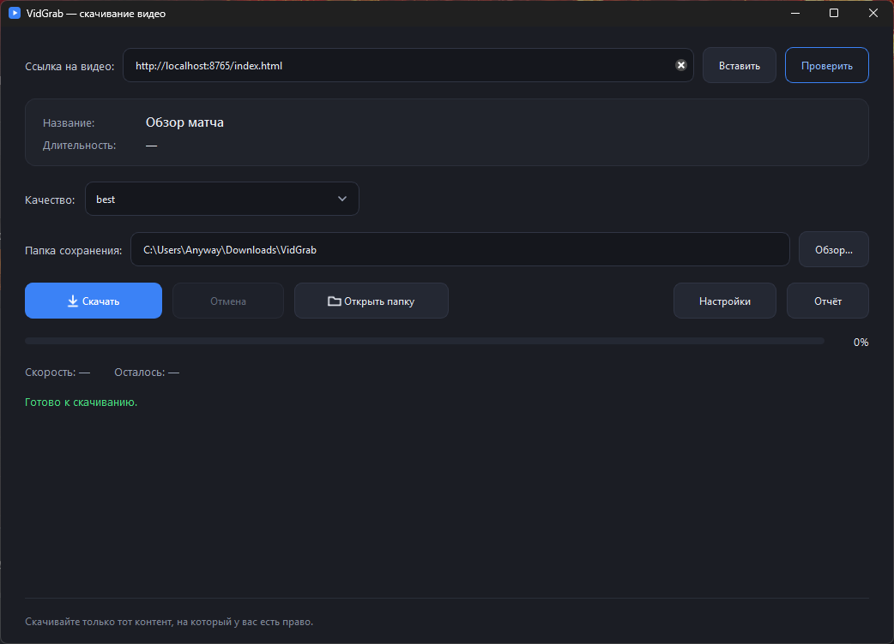
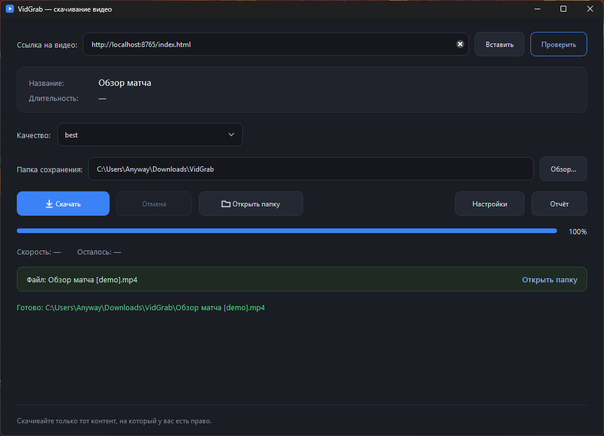

# VidGrab — скачивание видео по ссылке

Портативное приложение для Windows: вставляете ссылку на видео, выбираете качество и папку — видео скачивается с прогрессом. Не требует установки Python и ничего не пишет в системный реестр: достаточно распаковать папку и запустить `VidGrab.exe`.

> **Скачивайте только тот контент, на который у вас есть право.**



## Что умеет

- YouTube и VK Video (`vkvideo.ru`, `vk.com`), а также сайты, которые поддерживает встроенный `yt-dlp`;
- показывает название и длительность видео, доступные качества: `360p`, `480p`, `720p`, `1080p`, `best`;
- скачивает в выбранную папку, показывает проценты, скорость и оставшееся время;
- загрузку можно отменить — недокачанные файлы удаляются;
- кнопка «Открыть папку» доступна всегда и открывает папку из поля «Папка сохранения», даже если загрузки ещё не было;
- после каждого видео показывает имя файла и кликабельную ссылку «Открыть папку»; ссылка живёт до следующей загрузки и не восстанавливается после перезапуска. Если файл уже перемещён или удалён, откроется папка загрузки — без ошибок;
- запоминает последнюю папку и качество;
- кнопка «Отчёт» собирает диагностику в текстовый файл (версии, настройки, хвост лога, самопроверка);
- cookies браузера для случаев, когда сайт просит войти или подтвердить, что вы не бот;
- понятные сообщения об ошибках (нет сети, сервер отклонил загрузку, нет прав на запись и т.д.);
- сеть нужна только для проверки ссылки и загрузки видео.

## Требования

| Что | Значение |
|---|---|
| ОС | Windows 10/11 x64 (проверено на Windows 11 10.0.26300) |
| Python | не нужен |
| Свободное место | около 450 МБ (папка приложения) |
| Интернет | нужен только для проверки ссылки и загрузки |

## Установка и запуск

1. Скопируйте папку `VidGrab` целиком (в ней `VidGrab.exe` и папка `_internal`) в удобное место, например `D:\Apps\VidGrab`.
2. Запустите `VidGrab.exe`.
3. Не перемещайте `VidGrab.exe` отдельно от `_internal` — приложение не найдёт библиотеки, `ffmpeg` и JS-рантайм.

При первом запуске Windows SmartScreen может показать предупреждение (файл не подписан): «Подробнее» → «Выполнить в любом случае». Приложение не устанавливает службы и не лезет в автозагрузку.

## Как скачать видео

1. Скопируйте ссылку на видео и вставьте её в поле «Ссылка на видео» (кнопка «Вставить» берёт ссылку из буфера обмена).
2. Нажмите «Проверить». Появится название, длительность и список доступных качеств.
3. Выберите качество и папку сохранения (кнопка «Обзор…»).
4. Нажмите «Скачать». Прогресс, скорость и оставшееся время отображаются под кнопками.
5. При необходимости нажмите «Отмена» — загрузка остановится, недокачанный файл будет удалён.
6. После завершения под прогрессом появится панель с именем файла и ссылкой «Открыть папку». Кнопка «Открыть папку» в ряду действий открывает выбранную папку в любой момент.



Примеры ссылок:

```
https://www.youtube.com/watch?v=...
https://vksport.vkvideo.ru/video-29484355_456253450
```

Одна ссылка — одно видео. Плейлисты не поддерживаются.

### Качества

Показываются только реально доступные варианты из списка `360p`, `480p`, `720p`, `1080p`, `best`. `best` — максимальное доступное качество. Видео и звук при необходимости склеиваются в MP4 встроенным `ffmpeg`, поэтому итоговый файл всегда воспроизводимый.

### Если YouTube просит подтверждение

Публичные видео не защищены DRM. Но YouTube может попросить подтвердить, что вы не бот, или отклонить ссылку на поток с `HTTP 403`. Это не «встроенная защита» приложения — так ведёт себя сайт.

Что делать:

1. **Повторите попытку** или выберите другое качество — часто помогает.
2. Откройте «Настройки» и включите **cookies браузера** (Chrome, Edge или Firefox). Войдите в этом браузере в нужный аккаунт, закройте браузер и повторите загрузку. Cookies читаются локально и никуда не отправляются.
3. Если браузер не отдаёт cookies, укажите в настройках файл `cookies.txt` (формат Netscape), экспортированный расширением браузера.

Приложение не обходит DRM платных кинотеатров и не подменяет платную подписку — для этого нет ни технической, ни правовой возможности. Cookies — это обычный вход в ваш аккаунт.

## Где хранятся настройки и файлы

| Что | Где |
|---|---|
| Настройки | `%APPDATA%\VidGrab\settings.json` |
| Лог | `%APPDATA%\VidGrab\vidgrab.log` (ротация 1 МБ × 3) |
| Отчёты | `%APPDATA%\VidGrab\reports\report-ГГГГММДД-ЧЧММСС.txt` |
| Отчёт самопроверки | `%APPDATA%\VidGrab\selftest.json` |
| Скачанные видео | папка, выбранная в окне (по умолчанию `%USERPROFILE%\Downloads\VidGrab`) |

В лог и отчёт попадают ссылки и пути файлов — это нужно для диагностики. Cookies и их содержимое в отчёт не включаются. Приложение не отправляет телеметрию и не делает сетевых запросов, кроме обращения к сайту видео.

### Отчёт для диагностики

Нажмите «Отчёт» в главном окне (или запустите `VidGrab.exe --report`). Будет создан текстовый файл с версией приложения, ОС, версиями Python/Qt/yt-dlp/ffmpeg/qjs, настройками без cookies, последними 500 строками лога и результатом самопроверки. В диалоге можно сразу открыть папку с отчётом. Перед отправкой отчёта проверьте его на личные данные.

## Если что-то пошло не так

| Сообщение | Что делать |
|---|---|
| «Ссылка пустая или некорректная» | Проверьте ссылку: нужна `http://` или `https://` |
| «Нет подключения к интернету» | Проверьте сеть, VPN или прокси; повторите |
| «Сервер отклонил загрузку файла (HTTP 403)» | Повторите, выберите другое качество или включите cookies браузера в настройках |
| «YouTube просит подтвердить, что вы не бот» | Откройте «Настройки» и включите cookies браузера; либо повторите позже |
| «Не удалось прочитать cookies браузера» | Войдите в браузер, закройте его и повторите; либо укажите `cookies.txt` |
| «У видео нет потока в выбранном качестве» | Выберите другое качество или `best` |
| «Видео недоступно: приватное, удалённое или требует входа» | Ссылка ведёт на закрытое видео; включите cookies, если у вас есть доступ |
| «Видео защищено DRM» | Платный онлайн-кинотеатр; такие видео не поддерживаются |
| «Нет прав на запись в выбранную папку» | Выберите другую папку (например, `Downloads`) |
| «FFmpeg не найден» | Папка `_internal` повреждена или удалена — распакуйте приложение заново |
| «Ошибка загрузчика: …» | Подробности в `vidgrab.log`; сайт мог изменить API или видео удалено |
| «Загрузка отменена пользователем» | Это не ошибка — можно начать заново |

После ошибки или отмены прогресс сбрасывается в 0%, а панель результата скрывается — ничего не «висит».

Если ничего не помогает, нажмите «Отчёт» и пришлите получившийся файл — по нему видно, на каком шаге всё сломалось.

## Командная строка (необязательно)

```powershell
VidGrab.exe --cli "https://www.youtube.com/watch?v=..." --quality 720p -o "D:\Video"
VidGrab.exe --cli "https://vksport.vkvideo.ru/video-29484355_456253450" --quality best --json -o "D:\Video"
VidGrab.exe --cli URL --cookies-from-browser chrome
VidGrab.exe --cli URL --cookies "C:\path\cookies.txt" --youtube-client web
VidGrab.exe --selftest
VidGrab.exe --report
VidGrab.exe --version
```

`--json` печатает результат в машиночитаемом виде (удобно для скриптов). `--selftest` проверяет приложение, библиотеки, настройки, `ffmpeg` и `qjs`, пишет отчёт в `%APPDATA%\VidGrab\selftest.json`. `--report` создаёт текстовый отчёт и завершает работу.

## Ограничения

- Поддержка сайтов зависит от `yt-dlp`; проверены YouTube и VK Video. Экзотические сайты могут не работать.
- Плейлисты, очереди загрузок и история не поддерживаются.
- DRM, платные подписки и защищённый контент не обходятся. Cookies дают доступ только к тому аккаунту, в который вы вошли сами.
- Приложение не подписано — SmartScreen может предупредить при первом запуске.
- Проверялось на Windows 11 x64; на Windows 10 x64 должно работать (используются Python 3.11 и Qt 6.8), но отдельного стенда с Windows 10 не было.
- YouTube часто меняет защиту: встроенные `yt-dlp` и QuickJS решают текущие задачи, но со временем может понадобиться обновление приложения.

## Для разработчиков

Исходники и сборка:

```bash
# Linux/macOS (разработка и тесты)
python3 -m venv .venv
.venv/bin/pip install -r requirements-dev.txt
QT_QPA_PLATFORM=offscreen .venv/bin/python -m pytest -q
.venv/bin/python main.py

# Windows: сборка exe
powershell -ExecutionPolicy Bypass -File build.ps1
```

`build.ps1` создаёт `.venv`, ставит зависимости, при необходимости скачивает Windows-сборки `ffmpeg.exe`/`ffprobe.exe` (`tools/fetch_ffmpeg.*`) и QuickJS-ng `qjs.exe` (`tools/fetch_qjs.*`, версия и SHA-256 зафиксированы), затем собирает `dist\VidGrab\`. Для сборки на Linux без Windows-хоста есть `tools/build_in_docker.sh` (Docker + Wine).

`qjs` нужен `yt-dlp` для решения JS-задач YouTube: без него публичные видео могут отдавать ссылки, падающие с `HTTP 403`. В собранном приложении он лежит в `_internal\vidgrab\assets\qjs.exe`; путь можно переопределить переменной `VIDGRAB_QJS`.

Требования для сборки: Python 3.11+, PySide6 6.8, yt-dlp, PyInstaller 6.x. Папка `dist` — артефакт сборки и в git не хранится.

Структура: `main.py` — точка входа, `vidgrab/` — интерфейс, загрузчик, настройки, отчёт и самопроверка, `tests/` — тесты, `tools/` — сборка.
